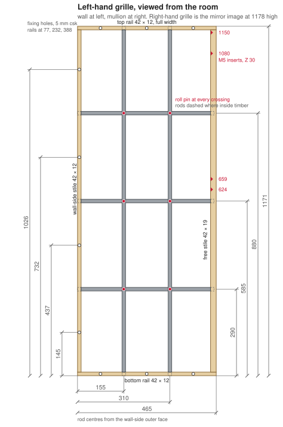
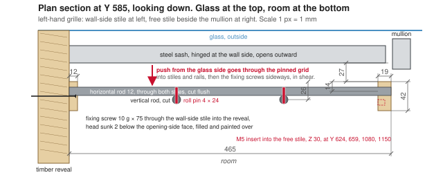
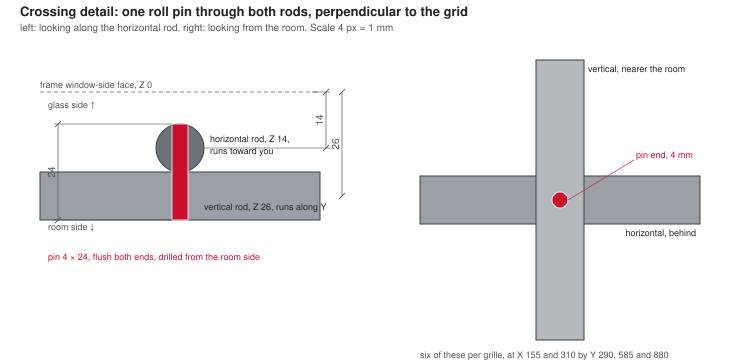
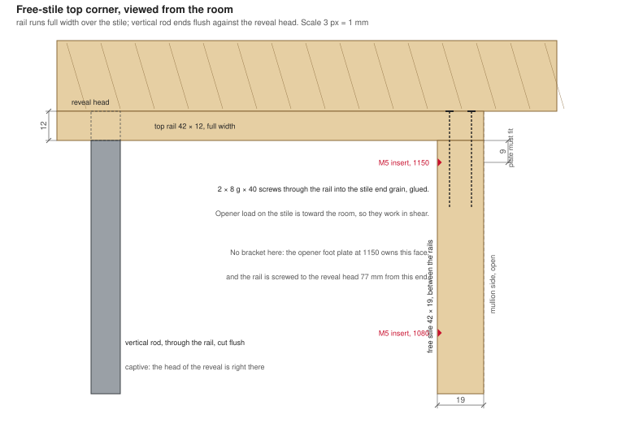
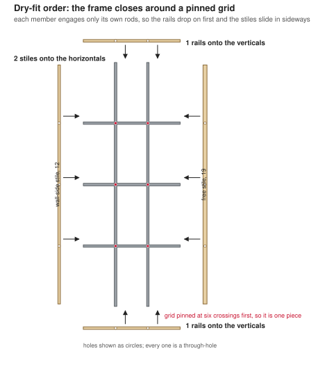

# Laneway window grilles: DIY build plan

29 Oct 2026, revised 3 Nov 2026. Thin timber frame painted white to match the
reveal, 12 mm steel rods painted matte black, pinned crossings. Fallback
to the fabricated version in `laneway-grilles_rfq.pdf`, which eight shops did
not answer. All dimensions in mm, all positions measured from the frame's outer
faces exactly as in the RFQ, so either version drops into the same reveal.

The RFQ says "plaster reveal". The reveal is solid timber. Correct the docx and
PDF before sending the RFQ out again.

## 1. What is being built

Two grilles, a left-hand and a right-hand, mirror images, for the two hinged end
bays of the steel casement. Each sits in the room-side timber reveal, its
window-side face 27 mm in front of the sash, fixed to the reveal on three sides
(wall-side stile, top rail, bottom rail). The fourth stile stands free beside the
mullion and carries the 24 V chain opener.

It is a deterrent, not a rated security screen. The deterrent is the 12 mm rod
grid. The frame holds the rod ends, carries the opener, and is painted the same
white enamel as the pine reveal so it reads as part of the window. It carries
almost no load: a push on the grid goes through the pinned
lattice into the reveal, and the opener load on the free stile is braced every
295 mm by the horizontals that pass through it.

| Item | Left | Right |
|------|------|-------|
| Frame outside W × H | 465 × 1171 | 465 × 1178 |
| Tolerance on outside | +0 / −2 | +0 / −2 |
| Square | diagonals within 2 | diagonals within 2 |

## 2. Decisions, and what was rejected

| Decision | Chosen | Rejected, and why |
|----------|--------|-------------------|
| Bars | 12 mm round mild steel | Timber bars: a 25 mm hardwood dowel kicks or saws out in seconds. Thinner steel: strength goes with diameter cubed, see table below. |
| Crossings | Drilled through both rods and roll-pinned, in the dry-fitted frame | Tack welds: need a welder or a shop, heat near timber, grinding. Half-lapped steel: 24 notches of grinding and filing. Tie wire or epoxy alone: unfixed crossings let a 1170 span of 12 mm rod bend by hand. |
| Frame section | 42 × 12 DAR edge-on, free stile 42 × 19 | 42 × 42 square: chosen first so rods could be housed in deep holes, but the frame carries no load that needs it, and deep holes need a drill press. Steel frame: that is the RFQ, still fine if a shop bites. |
| Frame timber | Tasmanian oak throughout, painted white to match the reveal | Hardwood oiled: the reveal is white-painted pine, and a bare hardwood frame inside it is a third material that draws the eye to the grille. Pine, painted: matches the reveal's timber and saves about $20, but holds the corner screws and the opener's M5 inserts worse and tears out at the rod holes. Pine rails with a hardwood free stile: two timbers to buy for a $10 saving. |
| Finish | Rods matte black, frame white enamel to match the reveal | White rods: from inside they are seen against daylight, and white catches glare by day and room light at night, so they stand out against the view. Black reads as thin dark lines the eye skips, like a fly screen. Clear-lacquered steel: shows fingerprints and rust spots at the cut ends and pin holes. |
| Rod ends | Through every member, cut flush, captive because the grid is pinned | Blind holes in the free stile: need 25 mm of timber, so need the 42 square. |
| Corners | Rails full width, stiles between, glued and screwed; the screws work in shear | End laps: need thick stock. Angle brackets: at the top corner a bracket on the stile's inner face sits exactly where the opener foot plate bolts on at 1150. |
| Spot welder | Not used | Fuses 3 to 5 mm crossings, not 12 mm. |
| Dense mesh (5 mm at 50 pitch) | Not used | Stronger and cheaper deterrent, but looks like a coop on the room side and the opener chain needs a cut-out. |
| Fixing | Ordinary screws sideways into the timber reveal, countersunk below the surface, filled and painted over | Room-side stop bead: was in the first version to hold the grille if the screws came out, but filled screws give nothing to aim a screwdriver at, and a bead's own screws can be reached through the 155 × 295 openings. Security or one-way screws: the filled heads cannot be found, and one-way screws have to be drilled out to remove the grille. |

Why 12 mm. Push at the centre of a 295 mm segment to permanently bend it,
crossings fixed:

| Rod | Push |
|-----|------|
| 12 mm | 58 kg |
| 10 mm | 34 kg |
| 8 mm | 17 kg |
| 6 mm | 7 kg |

Without fixed crossings a 1170 vertical bends at about 15 kg. The crossings are
not optional.

## 3. Geometry

Z is measured from the window-side face of the frame, into the room. X from the
wall-side outer face toward the mullion. Y from the bottom outer face. Every
member is 42 deep in Z and stands edge-on, so its thickness is what intrudes
into the opening.

*Left-hand grille from the room. Verticals are the rear layer so they draw over
the horizontals. Red dots are the roll pins, red triangles the opener inserts.*

### Frame members, per grille

| Member | Section (thick × deep) | Length | Notes |
|--------|------------------------|--------|-------|
| Top rail | 12 × 42 | 465 | Full width |
| Bottom rail | 12 × 42 | 465 | Full width |
| Wall-side stile | 12 × 42 | 1147 (left) / 1154 (right) | Sits between the rails |
| Free stile | 19 × 42 | 1147 / 1154 | Sits between the rails, carries the opener inserts |

If 42 × 12 is not in stock, 42 × 19 throughout is fine and costs 14 mm more of
opening.

### Rod layers

| Layer | Rods | Centre Z | Timber left in front / behind in the 42 depth |
|-------|------|----------|-----------------------------------------------|
| Front (toward glass) | Horizontals | 14 | 8 / 22 |
| Rear | Verticals | 26 | 20 / 10 |

Centres 12 apart, so the rods touch at every crossing. The RFQ had 6.5 and 18.5
because its rods were welded to the face of a 5 mm bar; here they pass through
holes and need timber either side. Stiles only carry horizontals and rails only
carry verticals, so no member has both layers and the holes never overlap.

*Plan section at the middle horizontal, glass at the top. The two rod layers sit
inside the 42 depth, the sash is 27 in front, and a push from the glass loads
the fixing screws sideways, in shear.*

### Rod holes, 12.5 mm, all through

| Member | Rods | Positions | Hole axis | Depth |
|--------|------|-----------|-----------|-------|
| Top rail | Verticals | X = 155, 310 | Y, at Z = 26 | 12 |
| Bottom rail | Verticals | X = 155, 310 | Y, at Z = 26 | 12 |
| Wall-side stile | Horizontals | Y = 290, 585, 880 | X, at Z = 14 | 12 |
| Free stile | Horizontals | Y = 290, 585, 880 | X, at Z = 14 | 19 |

Every hole goes through the thin dimension, so the deepest is 19 mm. A hand
drill with a bushing guide does all of them. Rod ends in the rails and the
wall-side stile sit against the reveal once installed. Rod ends in the free stile
are flush with its outer face, beside the mullion, and cannot move because the
grid is pinned to the verticals, which are housed in the rails.

### Rods, per grille

| Rod | Qty | Cut length | Runs |
|-----|-----|------------|------|
| Vertical | 2 | 1170 (left) / 1177 (right) | Flush with both rail outer faces |
| Horizontal | 3 | 464 | Flush with both stile outer faces |

About 3.7 m per grille, 7.4 m total. Three 3 m lengths, or one 6 m length plus
offcut from a steel merchant, which is cheaper.

### Crossings, per grille

Six, at X = 155 and 310 by Y = 290, 585 and 880. Each gets one 4 mm hole
through both rods, drilled perpendicular to the grid plane, and one 4 × 24 roll
pin. The hole takes about a third of the rod section at the node. On a six-node
deterrent grid that does not matter.

Alternative at any crossing: M4 button-head bolt and nyloc, head toward the
glass, nut on the room side. Use this if the pin holes end up oversize.

*One crossing. Left, looking along the horizontal rod: the pin runs in Z through
both rods, 24 long, flush. Right, from the room: all that shows is a 4 mm pin
end.*

### Corners

Rails run the full 465 and the stiles butt against their inside faces. Glue, two
8 g × 40 screws through the rail into the stile end grain at each corner, in
3 mm pilot holes so the 12 mm stile does not split. The
opener pushes the free stile toward the room, so those screws work in shear, not
withdrawal, and the rail is itself screwed to the reveal head 77 mm from that
end. No angle brackets: at the top corner a bracket on the stile's inner face
would sit exactly where the opener foot plate bolts on at 1150. The three fixed
sides are held by the reveal anyway.

*Free-stile top corner. The vertical rod runs through the rail and ends flush
against the reveal head. The top insert is 9 mm below the rail, which is the
clearance the opener foot plate has to fit in.*

### Fixing

Same positions as the RFQ. Each is a 5 mm hole through the 12 thickness,
countersunk on the opening-side face deep enough that the head sits 2 mm below
the surface, which leaves room for filler.

| Member | Positions |
|--------|-----------|
| Wall-side stile | Y = 145, 437, 732, 1026 |
| Top rail | X = 77, 232, 388 |
| Bottom rail | X = 77, 232, 388 |
| Free stile | none |

All clear of the rod holes.

Ordinary 10 g × 75 screws. They run sideways into the reveal, so a push from the
glass side loads all ten in shear, not withdrawal. The heads are filled and
painted over, so there is nothing to see or unscrew. A determined thief kicks
the grille in either way; the job is to make the window not worth the effort.
To remove the grille later, dig out the filler and unscrew.

### Opener inserts

Free stile, inner face (facing the opening), four M5 threaded inserts at
Y = 624, 659, 1080, 1150, Z = 30. Same on both grilles. Inserts are 10 mm long
in the 19 thickness. The 585 horizontal is at Z = 14 and 39 mm below the nearest
insert, so there is no clash.

Check the opener's chain run before committing: the RFQ geometry assumed a 50 × 5
steel stile with the rod plane 6.5 mm behind the window face. Here the stile is
42 deep and the front rod plane is 8 mm behind the window face.

## 4. Shopping list

Prices are rough, Melbourne, late 2026.

| Item | Qty | Note | Approx |
|------|-----|------|--------|
| 42 × 12 DAR Tasmanian oak | 2 × 1.8 m | One wall stile and two rails per length | $25 |
| 42 × 19 DAR Tasmanian oak | 1 × 2.4 m | Both free stiles | $20 |
| 12 mm round mild steel | 7.4 m | 3 × 3 m hardware lengths, or 6 m + 1.5 m from a merchant | $40 to $70 |
| Roll pins 4 × 24 | 12, buy 20 | Spring steel | $10 |
| M5 threaded inserts, screw-in brass, 10 long | 8, buy 10 | 8 mm pilot, check the insert's spec | $15 |
| 10 g × 75 countersunk timber screws | 20 | Through 12 of frame, 60 into the reveal | $8 |
| 8 g × 40 screws for the corners | 16 | Two per corner | $5 |
| Two-part wood filler | 1 | Over the fixing screw heads; sands flat and does not shrink back | $15 |
| Polyurethane or epoxy glue | 1 | Corners | $15 |
| Cold gal or etch primer, matte black enamel | 1 each | Rods | $30 |
| Timber primer, white enamel matching the reveal | 1 each | Frame. Use the reveal's leftover enamel if there is any | $30 |
| Rebar tie wire, cutting oil | | | $10 |

Total roughly $225 to $255.

## 5. Tools

| Tool | For | Have / buy |
|------|-----|------------|
| Hardened bushing drill guide with a V-groove base (Big Gator V-DrillGuide or similar, 1/2 in bushing) | Every hole: rod holes through the strips, pin holes through the rod | Buy, $60 to $80 |
| Hand drill, 13 mm chuck | | Have |
| 12.5 mm bit, reduced shank | Rod holes | Buy |
| 4 mm HSS bits | Pin holes | Buy a few |
| 5 mm bit, countersink | Fixing holes | |
| Hacksaw or angle grinder with cutting disc | Rods | |
| Tenon saw, square, tape, marking knife | Timber | |
| Four sash or F clamps, one pair locking pliers | Dry fit, crossings | |
| Centre punch, pin punch, hammer | Pin holes and roll pins | |
| Benchtop drill press | Nothing this design needs. Nicer for the rod holes, not required. | Optional |
| Spot welder | Nothing on this job | |

## 6. Build sequence

Do one grille start to finish before cutting the second. The second is the
mirror image: swap which end is the wall side.

### Timber

1. Cut rails and stiles to length. Check each pair against the other for equal
   length, not against the tape.
2. Mark the window-side face on every member. Every Z measurement comes from
   that face.
3. Mark every hole from the outer faces of the assembled frame, not from the
   member ends. The stiles sit 12 mm in from the rail outer faces, so a stile
   hole at Y = 290 is 278 from the stile's bottom end.
4. Gauge a line along each member at its hole Z (14 on stiles, 26 on rails),
   punch the centres, and drill the 12.5 holes through with the guide clamped
   on. Drill from the outside face so any breakout is on the inside.
5. Drill the fixing holes, 5 mm through, countersunk on the opening side. Drill
   the insert pilots in the free stile.

### Rods

6. Cut the rods. Deburr every end with a file so they enter the holes without
   tearing the timber.

### Dry fit

*Why the frame can close around a grid that is already pinned: each member only
engages its own rods. Rails first, then stiles.*

7. Lay the frame flat, window-side face down. Push the verticals through the
   bottom rail, then the top rail. Push the horizontals through the wall-side
   stile, then slide the free stile on over their other ends. Tape the
   horizontals so they cannot walk until they are pinned.
8. Clamp the corners and square the frame. Diagonals within 2.
9. Twist tie wire tight around each crossing so the two rods touch with no gap.
   A gap is where the drill wanders.

### Pin the crossings

10. Centre punch the top rod at each crossing. Sit the V-guide on it, 4 mm bit,
    about 2000 rpm, cutting oil, peck through both rods. Six holes.
11. Drive a 4 × 24 roll pin into each. Snip the tie wire. The grid is now one
    piece.

### Finish

12. Slide the frame members off. Degrease the grid, prime, matte black. Paint
    into the pin holes and over the cut ends, which is where it would rust.
13. Prime and paint the timber white enamel, masking the glue
    faces at the corners. Keep paint out of the rod holes or the rods will not
    slide back in; touch up around the rods after glue up.

### Glue up

14. Reassemble around the finished grid, same order as the dry fit. Glue the
    corners, clamp square, two 8 g × 40 screws through each rail end into the
    stile, in the pilot holes.
15. Fit the M5 inserts.

### Install

16. Offer the grille into the reveal, window-side face 27 mm in front of the
    sash. Shim to plumb and square.
17. Screw through the ten fixing holes into the reveal with the 10 g × 75s,
    heads 2 mm below the surface.
18. Fill over each head with two-part filler, slightly proud. Sand flush once
    cured, spot-prime, and touch up with the white enamel.
19. Fit the opener to the inserts, sash bracket, wiring. Outside this plan.

## 7. Done when

- Both grilles in, diagonals within 2, no rattle at any crossing.
- A hard shove on the middle of any rod from the window side moves nothing you
  can see.
- No screw head visible, opener opens and closes the sash through the grid.

## 8. Open questions

- [ ] Ring three of the eight fabricators with the short pitch before buying
      timber. "Two small welded grilles, flat bar and 12 mm rod, mild steel, you
      pick the finish, I have a drawing." If one bites, this plan is the backup.
- [ ] How much room-side depth does the reveal have before the architrave? The
      frame is 42 deep, where the RFQ needed 25 to 50.
- [ ] Opener chain run with a 42 deep stile and the rod plane 8 mm back.
- [ ] The top insert at 1150 is 9 mm below the rail underside here, against 16
      in the RFQ, whose rail was 5 mm in-plane. Check the foot plate fits.
- [ ] Is 42 × 12 Tasmanian oak in stock, or is it 42 × 19 throughout.
- [x] Rod finish: black or clear. Black, frame white (3 Nov, see section 2).
- [ ] Fix "plaster reveal" in the RFQ docx and PDF.
